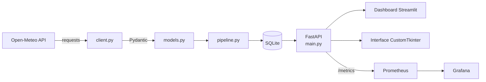

# 🌦️ L'Observatoire Météo

Pipeline de données météo complet : collecte depuis l'API **Open-Meteo**, validation, stockage en base, exposition via une **API REST**, visualisation dans un **dashboard** et **monitoring** de l'ensemble.


---

## ✨ Fonctionnalités

- **Collecte automatique** de la météo de plusieurs villes, toutes les 15 minutes
- **Validation des données** avec Pydantic avant toute écriture en base
- **Stockage** dans SQLite (tables `villes` et `releves`)
- **API REST** FastAPI avec documentation Swagger interactive
- **Dashboard Streamlit** : indicateurs clés, carte, filtres, rafraîchissement automatique
- **Interface de bureau** CustomTkinter (`gui.py`), compilable en `.exe` sous Windows
- **Monitoring** : métriques Prometheus et dashboard Grafana déjà provisionné
- **Orchestration** de tous les services avec Docker Compose
- 100 % open source

## 🏗️ Architecture



## 🚀 Lancement avec Docker (recommandé)

Prérequis : [Docker](https://docs.docker.com/get-docker/) et Docker Compose.

```bash
git clone https://github.com/guerguet-matisse/observatoire-meteo.git
cd observatoire-meteo
docker compose up --build
```

| Service               | URL                                | Rôle                                              |
|-----------------------|------------------------------------|---------------------------------------------------|
| API FastAPI + Swagger | http://localhost:8000/docs         | Endpoints météo                                   |
| Métriques Prometheus  | http://localhost:8000/metrics      | Exposées par l'API                                |
| Dashboard Streamlit   | http://localhost:8501              | Interface utilisateur                             |
| Prometheus            | http://localhost:9090              | Collecte des métriques                            |
| Grafana               | http://localhost:3000              | Dashboard « Observatoire Météo » (admin / admin)  |

L'API collecte automatiquement les villes définies par les variables d'environnement `COLLECT_CITIES` et `COLLECT_INTERVAL_MIN` (voir `docker-compose.yml`).

Arrêt des services :

```bash
docker compose down        # ajoute -v pour effacer aussi les données
```

> ⚠️ Le mot de passe Grafana par défaut (`admin` / `admin`) est prévu pour un usage local. Change-le avant tout déploiement.

## 🛠️ Lancement sans Docker

```bash
# 1. Installer les dépendances de l'API
pip install -r requirements.txt

# 2. Lancer l'API  ->  http://127.0.0.1:8000/docs
uvicorn main:app --reload

# 3. Lancer le dashboard  ->  http://localhost:8501
pip install -r dashboard/requirements.txt
streamlit run dashboard/app.py

# 4. (Optionnel) Interface de bureau CustomTkinter
python gui.py

# 5. (Optionnel) Collecte en ligne de commande
python pipeline.py Paris Lille
```

### Créer un exécutable Windows

```bat
build_exe.bat
```

Génère `ObservatoireMeteo.exe` à partir de `gui.py`.

## 📁 Structure du projet

```
observatoire-meteo/
├── models.py              # Modèles Pydantic (validation des réponses Open-Meteo)
├── client.py              # Appels HTTP à Open-Meteo (requests)
├── database.py            # Accès SQLite (sqlite3)
├── pipeline.py            # Collecte → validation → stockage
├── metrics.py             # Métriques Prometheus
├── main.py                # API FastAPI
├── gui.py                 # Interface CustomTkinter
├── dashboard/app.py       # Dashboard Streamlit
├── prometheus/            # Configuration Prometheus
├── grafana/               # Provisioning et dashboard Grafana
├── Dockerfile             # Image du dashboard
├── Dockerfile.api         # Image de l'API
├── docker-compose.yml     # Orchestration des services
├── requirements.txt
└── requirements-api.txt
```

## 🧰 Stack technique

| Couche            | Technologie                       |
|-------------------|-----------------------------------|
| Source de données | Open-Meteo (gratuit, sans clé)    |
| Client HTTP       | `requests`                        |
| Validation        | `Pydantic`                        |
| Base de données   | `SQLite`                          |
| API               | `FastAPI` + Swagger / OpenAPI     |
| Dashboard         | `Streamlit` + `Plotly`            |
| Application bureau| `CustomTkinter`                   |
| Monitoring        | `Prometheus` + `Grafana`          |
| Conteneurs        | `Docker` + `Docker Compose`       |

## 📚 Ce que ce projet m'a appris

- Consommer une API externe et valider proprement ses données
- Concevoir un pipeline de collecte et de stockage
- Exposer et documenter une API REST
- Mettre en place du monitoring (métriques, tableaux de bord)
- Conteneuriser et orchestrer une application multi-services

## 🗺️ Pistes d'amélioration

- [ ] Ajouter des tests automatisés (pytest) et une CI GitHub Actions
- [ ] Ajouter des alertes Grafana (canicule, gel, vent fort)

## 👤 Auteur

**Matisse Guerguet** — [GitHub](https://github.com/guerguet-matisse)
*Données météo fournies par [Open-Meteo](https://open-meteo.com/).*
